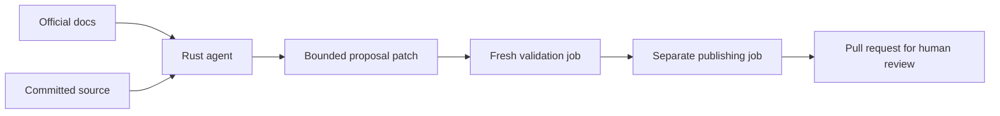

# Repo Maintainer

[](https://github.com/djsydney04/repo_maintainer/actions/workflows/ci.yml)
[](LICENSE)
[](Cargo.toml)

A Rust maintenance agent that reads official documentation, makes focused fixes,
validates them, and opens pull requests. Run it weekly through GitHub Actions or
produce a reviewable patch locally with Docker or a native binary.

Configure the target repository in **`.maintainer.yml`**. Choose Groq, Gemini,
OpenAI or Anthropic; keep API keys in environment variables or Actions secrets.
The built-in validation profile supports Rust repositories and SDK workspaces.



The maintainer is implemented entirely in Rust. The native binary and default
Docker image need no Python or Node runtime. A maintained repository's optional
package-check script may have its own runtime requirements.

## Native quick start

Install Rust 1.89 or newer and Git, then clone and install:

```sh
git clone https://github.com/djsydney04/repo_maintainer.git
cd repo_maintainer
cargo install --locked --path .
cd /path/to/your/rust-repository
repo-maintainer init
# Edit .maintainer.yml with your official docs and selected provider.
repo-maintainer check
# Export the selected provider's API key before running inference.
repo-maintainer run
```

`init` preserves existing settings. `check` validates configuration without API
requests. `run` clones the target's committed HEAD into a temporary directory,
fetches its locked Cargo dependencies, and edits the clone. The working tree is
not changed. Review `.maintainer-output/<run>/report.json` and `proposal.patch`.
Use `--output /path/to/new/directory` to select an empty output directory.

Native runs use your shell environment; `.env` is loaded only by Docker Compose.
Local `run` does not publish a pull request.

## Docker quick start

Clone this project beside the target repository. From the target repository:

```sh
../repo_maintainer/maintainer init
# Edit .maintainer.yml, then set your provider key in the shell or shared .env.
../repo_maintainer/maintainer check
../repo_maintainer/maintainer run
```

Docker with the Compose plugin is the only host dependency. The wrapper builds
the image and handles user IDs and output mounts. Copy this project's
[.env.example](.env.example) to `.env` for local keys; never commit real values.
The target is mounted read-only, and `.maintainer-output/<run>/` receives the
proposal. The image includes Rust, rustfmt, Clippy and Git for source checks.

For direct Compose use from this checkout:

```sh
REPOSITORY_PATH=/path/to/repository MAINTAINER_OUTPUT_PATH=/path/to/output \
  docker compose run --build --rm maintainer run --output /output/new-run
```

Docker does not schedule recurring maintenance. Use the reusable workflow below
or your own scheduler.

## Configuration

Start with [maintainer.example.yml](maintainer.example.yml). A minimal config is:

```yaml
version: 1
agent:
  provider: groq
sources:
  - https://developers.openai.com/api/docs/changelog
instructions: |
  Keep the Rust SDK aligned with the official docs.
  Preserve public APIs and add offline tests for behavior changes.
```

Documentation hosts are inferred from `sources`; `official_hosts` can extend
that allowlist. Redirects are checked before following them. By default, edits
may touch `README.md`, Markdown files directly in `docs/`, and Rust/Markdown/JSON
files under `src/` and `crates/`. Customize `editable` and `rust` in the example.

Version-1 JSON configs and `instructions_file` remain supported. Configuration
is discovered in `.maintainer.yml`, `.maintainer.yaml`, or `.github/maintainer`
with a `.yml`, `.yaml` or `.json` extension. Use `--config PATH` for an explicit
file. Unknown fields, duplicate keys, unsafe paths and excessive budgets fail
validation. YAML cannot contain API keys.

| Provider | Default model | Key environment variable / Actions secret | Protocol |
| --- | --- | --- | --- |
| `groq` | `openai/gpt-oss-120b` | `GROQ_API_KEY` | Chat Completions |
| `google` | `gemini-3.8-flash` | `GEMINI_API_KEY` | generateContent |
| `openai` (or `oai`) | `gpt-5.4` | `OPENAI_API_KEY` | Responses |
| `anthropic` | `claude-sonnet-4-6` | `ANTHROPIC_API_KEY` | Messages |

The Rust agent calls native HTTP APIs directly. Model IDs retain the previous
configuration defaults; they are examples rather than aliases for the latest
models. Actual access, price and quotas depend on your provider account.

OpenAI and Anthropic require an explicit paid-provider opt-in:

```yaml
agent:
  provider: openai
  model: gpt-5.4
  allow_paid: true
  max_requests: 16
```

Groq and Gemini can also incur charges with a billed account. No provider, model
or key fallback occurs. `SDK_MAINTENANCE_API_KEY` overrides the selected provider's
named key. Optional environment overrides are `MAINTENANCE_PROVIDER`,
`MAINTENANCE_MODEL` and `MAINTENANCE_ALLOW_PAID` (`true` or `false`). Changing the
provider selects its own default model unless a model override is also supplied.

## Weekly pull requests

Commit `.maintainer.yml` in the consuming repository and add a caller workflow:

```yaml
name: Weekly maintenance
on:
  schedule:
    - cron: '0 9 * * 1'
      timezone: America/Los_Angeles
  workflow_dispatch:
permissions:
  contents: read
jobs:
  maintain:
    permissions:
      contents: write
      pull-requests: write
      issues: write
      actions: write
    uses: djsydney04/repo_maintainer/.github/workflows/maintain.yml@FULL_COMMIT_SHA
    with:
      maintainer_ref: FULL_COMMIT_SHA
      config_path: .maintainer.yml
    secrets:
      GROQ_API_KEY: ${{ secrets.GROQ_API_KEY }}
      GEMINI_API_KEY: ${{ secrets.GEMINI_API_KEY }}
      OPENAI_API_KEY: ${{ secrets.OPENAI_API_KEY }}
      ANTHROPIC_API_KEY: ${{ secrets.ANTHROPIC_API_KEY }}
      SDK_MAINTENANCE_API_KEY: ${{ secrets.SDK_MAINTENANCE_API_KEY }}
```

Replace both `FULL_COMMIT_SHA` values with the same reviewed maintainer commit.
Keys belong in the **consuming repository's** Actions secrets. Enable Actions to
create pull requests, merge the caller/config, run it manually once, and inspect
the outcome. Schedules may be delayed. Optional workflow inputs override
`provider`, `model`, `allow_paid` and the assigned `owner`.

The proposal job has read-only GitHub access. The agent receives bounded read,
edit, write, search, official-reference and offline Cargo-check tools. It loads
no repository plugins or shell tools. Credentials and process-wrapper settings
are removed from child check environments.

A fresh job applies the exact patch and runs formatting, workspace tests and
doctests, Clippy, rustdoc, the configured Rust minimum, an optional package-check
script, and dependency audit. A separate job publishes only after validation,
updates or opens one assigned PR, and dispatches the target's CI workflow. The
CI workflow must support `workflow_dispatch`. An existing maintenance PR is
continued from its current head without force pushing.

`rust.package_check`, when set, names an executable in the consuming repository.
It must provide its own interpreter or be a compiled program; the maintainer
does not select a language runtime. The default has no package-check executable.

New blockers update one assigned issue. Identical blockers and successful no-ops
stay quiet; successful recovery closes the issue. Proposal artifacts are retained
for 30 days. Maintained repositories are never merged, deployed or released by
this agent.

## Limits and diagnostics

A run has at most 16 inference requests and a 20-minute agent deadline, including
counted context-compaction requests. Groq requests are paced 61 seconds apart,
Google requests 13 seconds, and the other providers 3 seconds. Provider errors
stop the run without retrying against another account. Oversized contexts,
incomplete model responses and unresolved work produce blockers with partial
patches retained when they fit the artifact limit.

Edits are limited to 25 regular non-executable files and a 500 KB patch. Changes
to dependencies, workflow files and other protected paths require human work.
The model cannot request arbitrary shell commands. Cargo checks execute source
and build scripts, so run only trusted repositories on dedicated infrastructure;
read [SECURITY.md](SECURITY.md) for the trust boundary.

`repo-maintainer smoke --config /path/to/.maintainer.yml` tests real inference,
editing and repair in a disposable failing Rust fixture. It uses at most six
requests over eight minutes and cannot publish source changes. The reusable
[smoke workflow](.github/workflows/smoke.yml) accepts the same provider settings
and secrets. Normal unit/integration tests do not make live inference requests.

## Development and community

```sh
cargo fmt --all --check
cargo clippy --locked --all-targets -- -D warnings
cargo test --locked
cargo run --locked -- check --config maintainer.example.yml
```

CI checks stable Rust and Rust 1.89 on Linux and macOS, and builds and exercises
the Docker image. Tests cover simulated native provider conversations, a real
offline Cargo repair loop, patch transfer, source guards, deadlines, configuration
and notification behavior. Passing fixtures does not establish live model access.

Contributions are welcome. See [CONTRIBUTING.md](CONTRIBUTING.md),
[the code of conduct](CODE_OF_CONDUCT.md), [security reporting](SECURITY.md), and
[project discussions](https://github.com/djsydney04/repo_maintainer/discussions).
Licensed under [MIT](LICENSE).

Provider references: [OpenAI function calling](https://developers.openai.com/api/docs/guides/function-calling),
[Anthropic tools](https://platform.claude.com/docs/en/agents-and-tools/tool-use/define-tools),
[Gemini function calling](https://ai.google.dev/gemini-api/docs/function-calling),
[Groq tool use](https://console.groq.com/docs/tool-use/overview).
