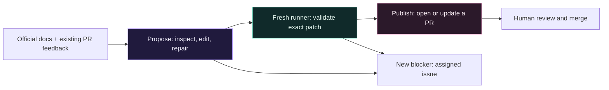

# How it works

[← Overview](../README.md) · [Configuration](configuration.md)

Repo Maintainer turns the documentation sources and boundaries you specify into
one focused proposal. A native Rust agent provides explicit tools, while Rust
workflow commands handle validation and GitHub writes. Neither the executable
nor the Docker image requires Python or Node.

## Cloud workflow

| Stage | Work | Access |
| --- | --- | --- |
| Propose | Read official docs and review/CI feedback; inspect, edit and repair files; export a patch/report | Selected model key and read-only GitHub token |
| Validate | Apply the patch to its original revision; check boundaries and run Rust validation | Fresh runner; no model key or GitHub write token |
| Publish | Reapply the validated patch, commit, open/update one assigned PR, dispatch target CI | Short-lived GitHub write token; no model key |
| Notify | Report a new failure, stay quiet for an identical blocker, close the issue on recovery | Issue-write permission |

The agent has file tools, an official-reference tool, and fixed offline Rust
checks. It has no general shell, repository plugins, subagents or GitHub-write
tools. Provider keys are removed from its environment before source tools and
checks run. Independent validation must succeed before publishing.

The documentation agent never force pushes, merges, releases or deploys. A human
reviews the resulting PR. Existing maintenance PRs receive review/CI feedback on
later runs. A separate [dependency merge integration](dependency-updates.md) can
merge eligible bot updates after CI when explicitly enabled by the consumer.

## Limits and incomplete work

| Boundary | Limit |
| --- | --- |
| Proposed patch | 25 regular files; 500 KB |
| Model requests | At most 16, including summaries; configurable downward |
| Agent deadline | 20 minutes |
| One agent Rust check | 5 minutes |
| Live diagnostic | 6 requests; 8-minute agent deadline |
| Cloud proposal retention | 30 days |

Groq uses small context pages, short excerpts, compaction and 61-second request
pacing for its free token budget. Google requests are paced 13 seconds apart.
Account quotas still apply. There is no automatic model/provider/key fallback.
A task that exceeds the budget stops and retains its partial patch for review.

A new blocker creates/updates one assigned issue with an owner mention. An
identical blocker does not repeatedly mention the owner. Successful no-ops stay
quiet; a later successful run closes the blocker issue. GitHub notification
preferences control delivery.

## Local execution

The container reads the target repository's committed HEAD through a read-only
mount, creates a temporary working copy, fetches Rust dependencies, and asks the
agent for a proposal. A writable output mount receives the patch and report.
You decide whether to apply it. Local Docker runs do not publish PRs or create
a recurring schedule.

The native `repo-maintainer run` command uses the same temporary-clone and patch
workflow. It requires Git and the Rust check tools in your shell environment.
Unlike Compose, it does not load a `.env` file automatically.

The Docker image contains the runtime and check tools. API keys are supplied at
runtime, and the build context excludes local environment files. The wrapper
handles user IDs, repository/output paths and preserving an existing config.

## Deployment and model tests

The shared CI checks formatting, linting and Rust tests on Linux and macOS with
stable Rust and Rust 1.89, then builds/runs the Docker image. Tests exercise HTTP
authentication, provider tool continuations, real offline Cargo repair, patch
transfer and notification behavior with simulated model responses.
These offline tests do not demonstrate account quota or live model quality.
The optional `smoke.yml` instead verifies a real key, file editing and test repair
in a disposable Rust fixture; paid providers require explicit opt-in and keys.
