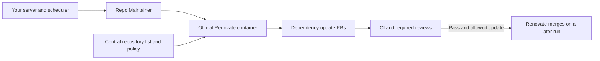

# Run Renovate on your infrastructure

[← Overview](../README.md) · [Cloud setup](getting-started.md#weekly-cloud-maintenance)

Repo Maintainer can run the official Renovate container on your own machine or
server. Renovate discovers dependency updates, refreshes lockfiles, opens PRs,
rebases its existing updates and merges eligible PRs once checks pass. This path
makes **zero model calls** and does not need GitHub Actions or a hosted Renovate
app. Docker runs the job; your scheduler decides when to run it.



## Docker setup

From a checkout of Repo Maintainer on your server:

```sh
./maintainer dependencies init
```

Edit the generated `renovate.config.json` and put the repositories you own in its
`repositories` list, for example `["your-org/api", "your-org/web"]`. This is one central
configuration for all listed repositories. The supplied settings are:

| Update | Behavior |
| --- | --- |
| Patch | Merge after passing checks and required reviews |
| Minor, major, unknown, pin or digest update | Leave for human review |
| Missing, pending or failed checks | Keep the PR open |

The example sets `requireConfig: "ignored"`, so repositories do not need their own
Renovate config. All update/merge rules come from this central file. Use
`requireConfig: "optional"` if you want repository configs to participate; their
rules may then change the effective merge policy. To also merge minor updates,
change `matchUpdateTypes` to `["patch", "minor"]` in the central file.

Create a `.env` in the Repo Maintainer checkout with `RENOVATE_TOKEN` set to your
Renovate bot account's token. Scope it to the listed repositories and grant the
[permissions Renovate needs](https://docs.renovatebot.com/modules/platform/github/).
An existing hosted Renovate app is unnecessary. Keep meaningful required CI
checks and reviews enabled on your default branches.

```sh
# Validate using Renovate itself. No token or model key is needed for this check.
./maintainer dependencies check

# Preview updates and merge decisions without writing branches or PRs.
./maintainer dependencies run

# Enable actual updates, PR creation and eligible merges.
./maintainer dependencies run --apply
```

`--config /absolute/path/renovate.json` selects another central config for any of
these commands. `init` preserves an existing file. Both preview and live runs
validate the configuration before running Renovate. A run exits after processing
the repository list; repeat it to discover releases and merge PRs whose checks
have since passed. Renovate handles version classification and merge decisions
itself, including grouped dependency updates.

The default image is pinned by digest in [`renovate-image.txt`](../renovate-image.txt)
and supports Linux AMD64 and ARM64. `MAINTENANCE_RENOVATE_IMAGE` can select another
image pinned with `@sha256:DIGEST`. The container receives the central config
read-only and a named cache volume. It receives no source mount, Docker socket or
model keys. Renovate logs are sent directly to the terminal or scheduler.

## Native executable

With Repo Maintainer installed and Docker available on the host:

```sh
repo-maintainer dependencies-init
# Edit renovate.config.json and export RENOVATE_TOKEN in the host environment.
repo-maintainer dependencies --validate-only
repo-maintainer dependencies
repo-maintainer dependencies --apply
```

Use `--config /absolute/path/renovate.json` to share the same configuration with
the Docker wrapper. Native commands use exported environment variables and do
not load `.env` files. Neither path requires a model key or a Node installation
on the host. The native dependency command delegates to Docker and preserves
its exit status and signal handling.

## Schedule on your server

The example [service](../deploy/systemd/repo-maintainer-dependencies.service) and
[timer](../deploy/systemd/repo-maintainer-dependencies.timer) run every 30 minutes.
Copy them into `/etc/systemd/system/`, adjust the account and checkout path, put
the central JSON in `/etc/repo-maintainer/renovate.json` and the token in
`/etc/repo-maintainer/renovate.env`. The service account needs permission to use
Docker and read these files. Restrict the token file to that account.

```sh
sudo systemctl daemon-reload
sudo systemctl enable --now repo-maintainer-dependencies.timer
journalctl -u repo-maintainer-dependencies.service
```

A systemd timer does not start another copy of an already running service. Other
schedulers can run the same `./maintainer dependencies run --apply` command;
configure them to prevent overlapping runs. The machine must stay on for its
scheduler to run. The supplied service enables live writes, so validate and
preview the repository list before enabling the timer.

Renovate manages PRs created by its own bot account. It does not adopt existing
Dependabot PRs. When moving a repository to this runner, choose which bot owns
updates for each ecosystem to avoid duplicate PRs. Repo Maintainer's coding
agent continues to produce proposals for human review separately.

References: [self-hosting Renovate](https://docs.renovatebot.com/examples/self-hosting/),
[central configuration](https://docs.renovatebot.com/self-hosted-configuration/),
and [CI-aware auto-merge](https://docs.renovatebot.com/key-concepts/automerge/).
