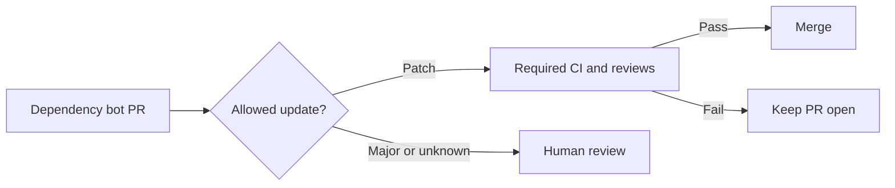

# Merge dependency updates without a model

[← Overview](../README.md) · [Cloud setup](getting-started.md#weekly-cloud-maintenance)

Use your existing dependency bot to create updates and CI to decide when they
can merge. No model key, inference request, Rust build or `.maintainer.yml` is
needed for dependency merging. These integrations work with any language.

| Update | Default behavior |
| --- | --- |
| Patch | Automatically merge after required checks and reviews |
| Minor | Human review; optionally enable automatic merging |
| Major or unknown | Human review |
| Failed CI or missing required review | Wait for resolution |



Choose the integration for the bot already installed in each managed repository.
Avoid having Dependabot and Renovate create competing updates for the same files.
The documentation maintenance agent continues to propose PRs for human review;
dependency merging is a separate, explicit opt-in.

## Dependabot: one shared action

Keep the consuming repository's existing `.github/dependabot.yml`. Add this as
`.github/workflows/dependency-automerge.yml` in that repository:

```yaml
name: Dependency auto-merge
on:
  pull_request_target:
    types: [opened, synchronize, reopened, ready_for_review]
permissions:
  contents: read
jobs:
  dependencies:
    if: github.event.pull_request.user.login == 'dependabot[bot]'
    runs-on: ubuntu-latest
    permissions:
      contents: write
      pull-requests: write
    steps:
      - uses: djsydney04/repo_maintainer/.github/actions/dependency-automerge@FULL_COMMIT_SHA
```

Replace `FULL_COMMIT_SHA` with a reviewed commit containing this action. In the
consuming repository's **Settings → General → Pull Requests**, enable **Allow
auto-merge** and **Allow squash merging**. Configure at least one meaningful
required CI check on the default branch through branch protection or an active
ruleset. The action fails with setup instructions if these settings are absent.
Keep the normal CI workflow running on `pull_request`; the merge action does not
run the tests itself.

Merge the caller into the default branch. New or updated Dependabot PRs are then
evaluated automatically. To reevaluate an existing open PR, close and reopen it.
GitHub waits for required checks and reviews; if all requirements are already
met, the action can merge immediately. It requests no approval or rule bypass.
Repository or organization policies can restrict the token's write permissions.

To also allow minor updates, add:

```yaml
        with:
          allow-minor: 'true'
```

The action uses verified Dependabot commit metadata, checks every dependency in
grouped PRs, verifies every commit's bot identity and signature, and rejects stale
heads, forks, drafts and non-default targets. Unknown metadata stays for human
review. The `result` output is `requested`, `already-enabled` or `skipped`.

This privileged `pull_request_target` job must contain only the pinned action.
Do not add a PR checkout, dependency installation, tests or other execution of PR
contents to it. The action loads its own pinned code and only uses the GitHub API
and the runner's GitHub CLI. No personal access token or model secret is needed.

## Renovate: one shared preset

For repositories with Renovate installed, add this preset to their existing
`renovate.json`:

```json
{
  "extends": [
    "config:recommended",
    "github>djsydney04/repo_maintainer:renovate-patch#FULL_COMMIT_SHA"
  ]
}
```

Pin a reviewed commit containing `renovate-patch.json`. The preset enables
Renovate's own patch PR merging and requires passing tests. Platform auto-merge
is disabled so Renovate checks CI itself, including when GitHub has no required
checks configured. Keep meaningful required CI checks and reviews on the default
branch as well. Renovate merges on a later run, so a green PR may wait for its
next cycle. No additional Actions workflow or model is needed.

For patch and minor updates, append a rule to the consuming configuration:

```json
"packageRules": [
  {"matchUpdateTypes": ["patch", "minor"], "automerge": true}
]
```

Other local presets and rules can override these settings. Review the resolved
Renovate configuration when combining merge policies. Major updates remain for
human review with the configuration shown here.

References: [GitHub's Dependabot automation](https://docs.github.com/en/code-security/tutorials/secure-your-dependencies/automate-dependabot-with-actions),
[Renovate auto-merge](https://docs.renovatebot.com/key-concepts/automerge/), and
[shared preset syntax](https://docs.renovatebot.com/config-presets/).
