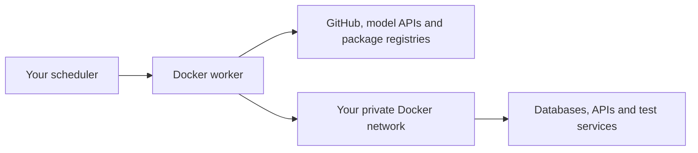

# Docker networking on your infrastructure

[← Overview](../README.md) · [Self-hosting](self-hosting.md) · [Configuration](configuration.md)

The worker runs on your server and makes outbound connections to GitHub, the
selected model provider, package registries and services reachable from its
Docker network. No incoming port, public URL or webhook endpoint is needed.
Normal Docker bridge networking is the default.



## Start a worker

From the target repository, with Repo Maintainer checked out beside it:

```sh
../repo_maintainer/maintainer init
# Add your task, editable paths and test commands to .maintainer.yml.
# Set CODEX_API_KEY in your shell or the Repo Maintainer checkout's .env.
../repo_maintainer/maintainer check
../repo_maintainer/maintainer run
```

New configs use version 2: Codex, general project checks and outbound access for
Codex's workspace-write tools. `agent.allow_paid: true` explicitly permits use of
the configured account. The initial whitespace check is a starting point; add
your repository's tests, lint and build commands before unattended code work.

The default Debian worker includes native Codex, Git, GitHub CLI, Python and build
tools. Select your project's tools with `MAINTAINER_RUNTIME_IMAGE`, for example
`node:24-bookworm`, `python:3.13-bookworm`, `golang:1.26-bookworm` or
`rust:1.89-slim-bookworm`. Set the variable in the checkout's `.env` or shell.
The image compiles the maintainer in a separate Rust build stage.

## Other containers and private services

Attach the worker to an existing Docker network used by your services:

```sh
export MAINTAINER_PRIVATE_NETWORK=my-services
export MAINTAINER_COMPOSE_FILES=compose.private-network.yml
../repo_maintainer/maintainer run
```

Containers on that network are reachable by their service/network alias, such as
`database:5432` or `http://test-api:8080`. The worker also keeps its normal outbound
Docker network. The private network must already exist on the same Docker host.

`host.docker.internal` points to the Docker host gateway, including on Linux.
Host services must listen on an interface reachable from that gateway. On Linux,
a service bound only to `127.0.0.1` is not reachable through a bridge gateway.
Private IPs and VPN routes work when your Docker host routes and permits
container traffic to those destinations. The worker does not establish a VPN;
attach it to your existing network or use your infrastructure's outbound proxy.

For private DNS, add `compose.dns.yml` and set a DNS server reachable from the
container:

```sh
export MAINTAINER_DNS_SERVER=10.0.0.53
export MAINTAINER_COMPOSE_FILES=compose.private-network.yml:compose.dns.yml
```

## Outbound proxies

Set `HTTP_PROXY`, `HTTPS_PROXY`, `ALL_PROXY` and `NO_PROXY` as needed in the shell
or the checkout's `.env`. Lowercase variants are supported too. These values
reach Codex and configured setup/test commands, while model and publisher keys
are removed from test environments. Proxy URLs are redacted from worker error
reports because they can contain credentials.

Include private service names and domains in `NO_PROXY` when they should connect
directly. Proxy settings do not create access to a private network by themselves.
Docker image pulls and Docker build networking are controlled separately by
your Docker daemon/build configuration.

## Private certificate authorities

Use a PEM bundle containing your private CA and the normal public root CAs.
Mount it read-only with the CA overlay:

```sh
export MAINTAINER_CA_BUNDLE=/etc/my-company/full-ca-bundle.pem
export MAINTAINER_COMPOSE_FILES=compose.private-network.yml:compose.ca.yml
../repo_maintainer/maintainer run
```

The overlay sets trust paths for the native HTTP clients, Codex, Git, curl,
Python, Node, pip and npm. Certificate verification remains enabled. The bundle
must be readable by the container user. Configure daemon trust separately when
pulling images from a private registry with a private CA.

`MAINTAINER_COMPOSE_FILES` is a colon-separated list of overlays, set in the shell
that launches the wrapper. Relative names resolve against the Repo Maintainer
checkout. Overlay settings such as the private-network name and CA path can be
kept in that checkout's `.env`. Direct Compose invocations use the same files
with repeated `-f` arguments.

## Execution boundaries

The container runs as an unprivileged user. The target checkout is read-only;
the agent edits a temporary clone and returns its patch/report through `/output`.
There is no Docker socket mount, privileged mode or inbound listener. Connect
only the private networks and services needed for the task: the agent's commands
and project tests can use the network access you provide.

Codex keeps `workspace-write` by default. Set `agent.codex.network_access: false`
to block tool networking inside that sandbox. Workers whose runtime cannot run
the nested sandbox must be configured explicitly for an externally isolated
execution mode; no silent sandbox fallback occurs. See
[Codex's network configuration](https://learn.chatgpt.com/docs/config-file/config-reference).

`run` produces local proposal artifacts. Use the existing self-hosted PR workflow
or separate [pipeline stages](self-hosting.md#compose-the-stages-in-code) when
your scheduler should also validate and publish PRs. Supply a GitHub write token
only to the publishing stage. The [self-hosting guide](self-hosting.md) describes
scheduling and project-specific runtime setup.
